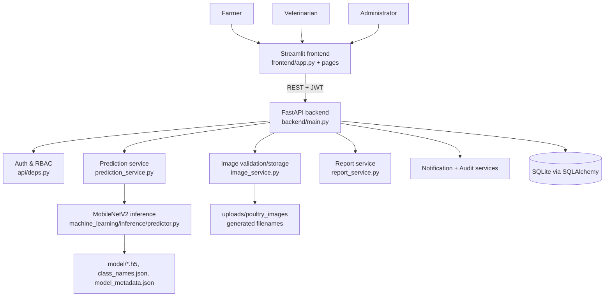
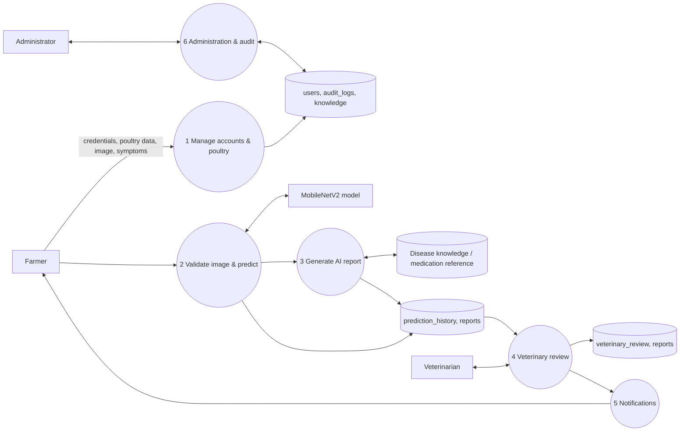
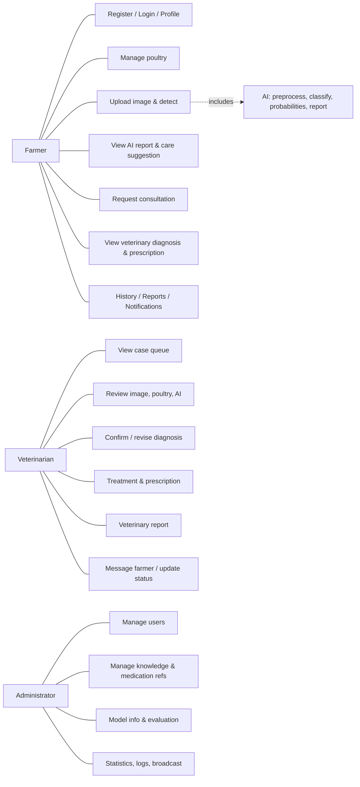
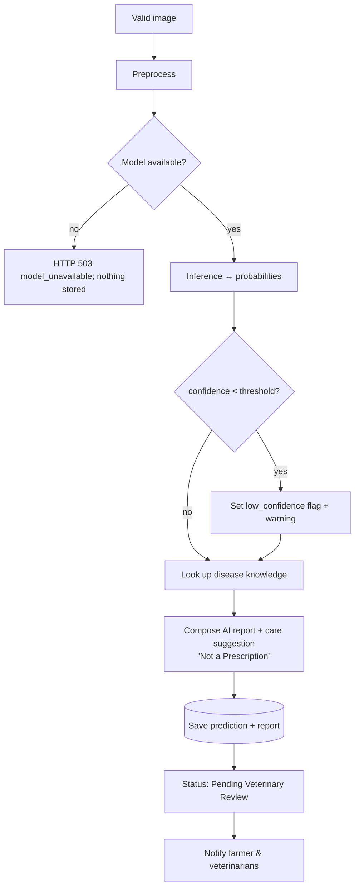
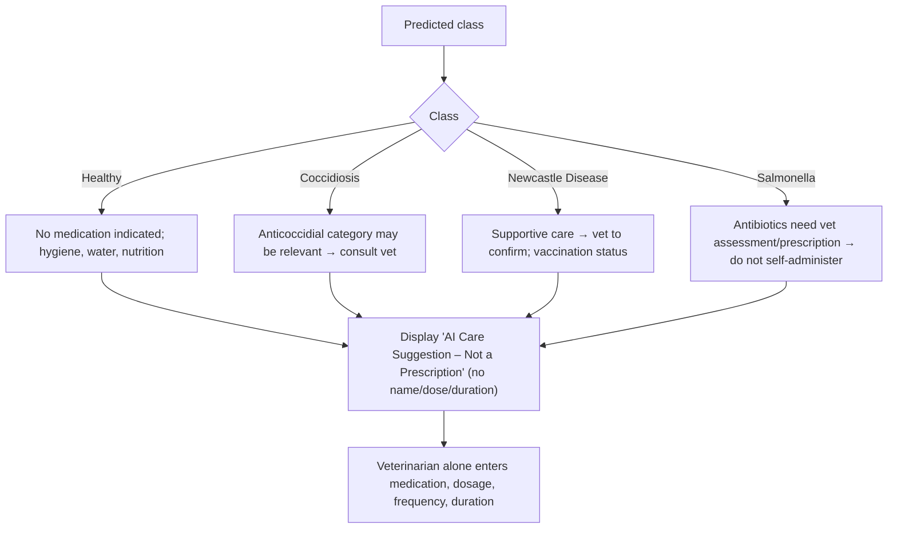
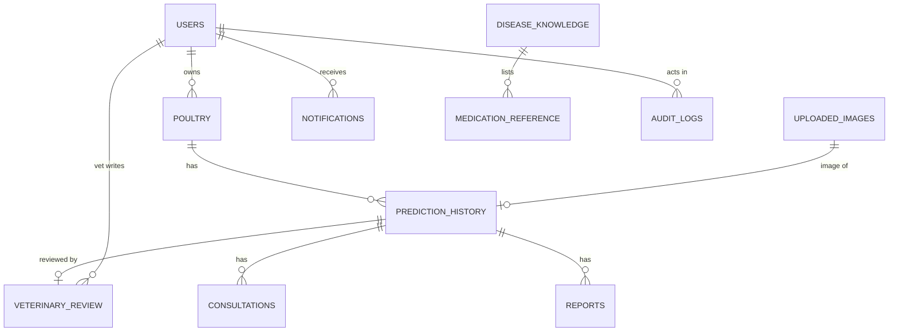

# Architecture (matches the implemented code)

## 1. System architecture

## 2. End-to-end block diagram

```mermaid
flowchart LR
  A[Farmer login] --> B[Register poultry] --> C[Upload image] --> D[Validate type/size/readability/dimensions]
  D --> E[Preprocess 224x224x3] --> F[MobileNetV2] --> G[4-class softmax]
  G --> H[Confidence + probabilities] --> I[AI report + knowledge base + care suggestion]
  I --> J[(prediction_history)] --> K[Veterinary queue]
  K --> L[Veterinarian review] --> M[Confirm / revise diagnosis] --> N[Treatment + prescription]
  N --> O[Veterinary report] --> P[Farmer notification & view]
```

## 3. Level-1 DFD

## 4. Use-case diagram

## 5. Input design
| Screen | Field | Rules |
|---|---|---|
| Register | name, email, password, phone, location, licence (vets) | email format; password ≥ 8 with letters+digits/symbols; vets need licence |
| Poultry | type, breed, age (weeks), flock size, production, health history | flock ≥ 1, age 0–500 |
| Detect Disease | poultry, image, symptoms, observations | JPG/JPEG/PNG, ≤ 5 MB, ≥ 64 px, real image content |
| Veterinary review | diagnosis, assessment, treatment, medication, dosage, frequency, duration, instructions, follow-up, comments | prescription needs dosage+frequency+duration; "confirmed" must equal AI class |

## 6. AI report generation flowchart

## 7. Medication recommendation flowchart

## 8. ER diagram

Full column definitions: `database/schema.sql`, `docs/database.md`.

## 9. Design decisions
* Single source of truth for class order (`backend/core/config.py`); folder names map to labels explicitly.
* Normalisation lives **inside** the Keras model (`Rescaling`), so training and inference cannot diverge.
* Predictor is a FastAPI dependency → swappable/testable; missing model ⇒ explicit 503, never fake output.
* AI and veterinary data live in different tables/fields/reports and different UI sections.
* Record-level access control (`get_prediction_for_user`) on every endpoint, not only role checks.
